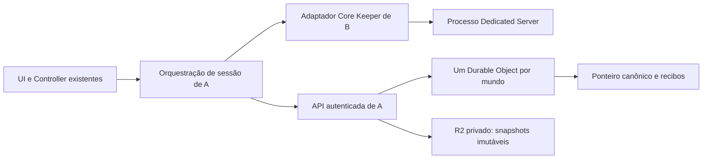
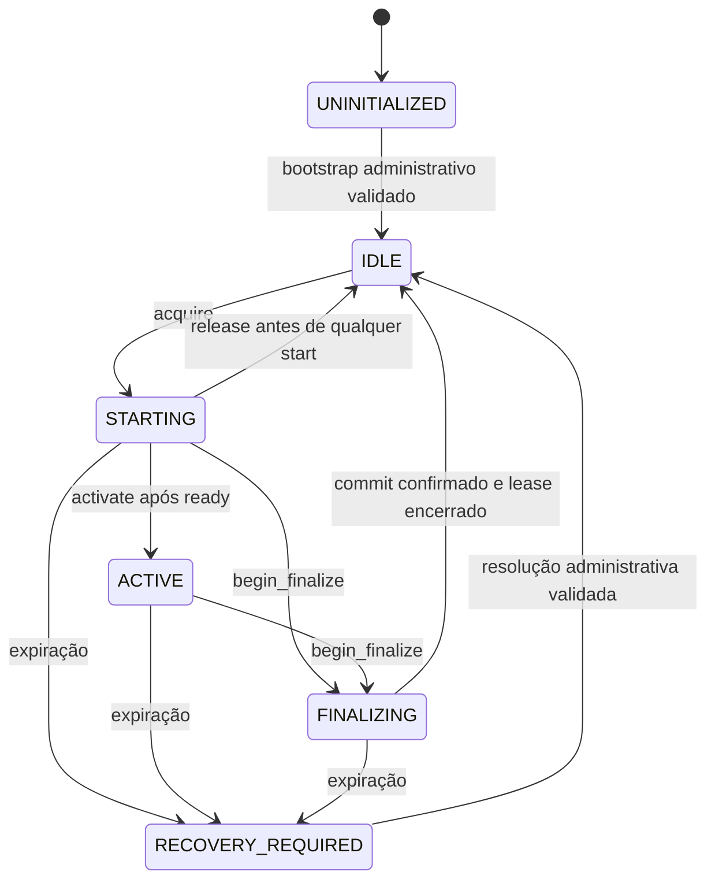

# Contrato compartilhado: hospedagem Core Keeper, revisão 1

Especificação normativa para implementação futura. A preparação não introduz
classes abstratas, stubs de produção nem dependências. Usar funções/objetos
Python simples e dataclasses quando houver consumidores reais. Os nomes e campos
abaixo são a fronteira combinada; mudanças exigem atualizar este documento e os
testes de ambas as frentes no mesmo incremento.

## Objetivo e menor arquitetura suficiente

O primeiro cliente que adquirir autoridade baixa o snapshot canônico, inicia o
Dedicated Server no próprio PC e anuncia o Game ID. Os demais apenas ingressam.
Ao terminar, o host para o servidor, publica um snapshot completo e libera o
mundo. O estado do jogo nunca é mesclado automaticamente entre sessões.

Modo novo explícito `hosting_mode="core_keeper_dedicated"`; ausente significa
fluxo legado. Sem fallback do novo modo para `sync.do_push/do_pull` ou pasta cloud
se a API estiver indisponível. Nenhuma mudança de semântica no manifesto legado.
Campos propostos na config existente: no mundo, `hosting_mode`,
`canonical_world_id`, `coordinator_url`; em `games.core_keeper.server`, caminhos
locais de instalação/SteamCMD/dados e opções permitidas. Credencial é local,
nunca em convite público, snapshot ou config exportada. A implementa persistência
e validação; B fornece as opções e validações de instalação. Não gravar config
concorrentemente a partir de workers.

`world["id"]` atual identifica registro local; `world_name` do Core Keeper é slot;
`canonical_world_id` é uma identidade global opaca compartilhada pelos membros.
O Game ID é endereço de ingresso da sessão. Nenhum desses identifica o outro.
O coordenador vincula mundo a grupo, jogo, slot e revisão de layout.

## Responsabilidades e fronteiras

| Superfície | Dono |
| --- | --- |
| Coordenação, autenticação/autorização, tempo, leases, fencing, recibos, R2, recuperação administrativa | A |
| Orquestração Python, download/staging/snapshot, ordem das chamadas, heartbeat em paralelo ao lifecycle, gates do controller/config | A |
| SteamCMD, versão instalada, argumentos, dados específicos do jogo, processo/filhos, readiness/Game ID, stop e evidência de parada | B |
| Inventário de arquivos por layout/build | B define padrões e casos sintéticos; A aplica limites, hashing e validação de transporte |
| UI de instalar/hospedar/ingressar/parar e exibir Game ID/erro | B, consumindo estado do controller; A fornece callbacks seguros |
| Arquivos compartilhados controller.py/config.py/window.py | A integra alterações de lógica; B limita alterações de UI aos sinais combinados, sem editar os fluxos distribuídos |

B não importa SDK Cloudflare nem implementa lease/mutex/commit. A não manipula
stdin, sinais Windows, SteamCMD ou argumentos internos do servidor. Nenhum
adaptador deve iniciar automaticamente um servidor no import ou em `prepare`.

## Dados e erros

As estruturas abaixo são conceituais, não um requisito de framework/serialização.
Chamadas de rede têm autenticação de membro e `protocol_version=1`.

- `Lease`: `world_id`, `session_id` aleatório, `owner_id` autenticado,
  `fence` inteiro estritamente crescente por mundo, `expires_at` UTC do serviço,
  `base_version`, `renewal_seq` (inicialmente 0), `lease_secret` não exposto em status. Transporte de fence/versão
  como string decimal se o runtime não representar int64 exatamente.
- `Head`: `world_id`, `version`, `snapshot_id`, `sha256`, `size_bytes`,
  `layout_id`, `slot`, `server_build`. Um download é sempre fixado nesse head.
- `Status`: `state`, `head`, `server_time`, owner público, session_id/fence,
  validade do lease, `game_id` somente em ACTIVE não expirado, `reason` se bloqueado.
  Para o dono, aceitar consulta por `request_id` e retornar recibo da operação;
  status não devolve segredo de lease a outro membro.
- `Snapshot`: staging fechado somente leitura, inventário ordenado de caminhos,
  bytes e SHA-256 por arquivo; fingerprint existente; layout/slot/build e
  base_version; SHA-256 e tamanho do pacote. Não incluir processos, executáveis,
  tokens, Game ID, logs ou configurações privadas do host.
- `CommitReceipt`: `request_id`, `session_id`, `fence`, `base_version`,
  `new_version`, `snapshot_id`, `sha256`, `committed_at`. É persistente e consultável.

Erros de coordenação têm `code`, mensagem segura e `retryable`. Códigos comuns:
`UNAUTHORIZED`, `FORBIDDEN`, `UNSUPPORTED_PROTOCOL`, `WORLD_NOT_FOUND`,
`UNINITIALIZED`, `BUSY`, `RECOVERY_REQUIRED`, `LEASE_EXPIRED`, `FENCED`,
`INVALID_STATE`, `BASE_MISMATCH`, `INVALID_SNAPSHOT`, `INTEGRITY_ERROR`,
`IDEMPOTENCY_CONFLICT`, `UNAVAILABLE`, `OUTCOME_UNKNOWN`. Não converter timeout,
JSON corrompido ou 5xx em IDLE, aquisição ou publicação bem-sucedida.

Toda mutação recebe `request_id` único por operação lógica, persistido antes do
envio, junto com digest dos argumentos. Repetição idêntica retorna o mesmo recibo;
mesmo ID com outros argumentos é conflito. Heartbeats distintos usam IDs
distintos; retry do mesmo heartbeat não renova de novo. Consultar recibos exige
autorização original. Reenviar uma operação não repete efeitos no servidor local.

## Operações de coordenação (implementadas por A)

Todas validam grupo/mundo/protocolo. Exceto leitura de recibo já concluído,
mutação de sessão exige owner + session_id + lease_secret + fence atuais e
`server_now < expires_at`, inclusive dentro da transação de commit.

| Operação | Entrada e saída | Condição/efeito e erros específicos |
| --- | --- | --- |
| `acquire(world_id, request_id)` | Retorna Lease + Head + server_time | IDLE com head válido -> STARTING. Incrementa fence e fixa base_version atomicamente. Concorrente perde com BUSY; bloqueio retorna RECOVERY_REQUIRED. Não cria mundo implicitamente. |
| `heartbeat(lease, request_id)` | Lease com nova validade + estado + server_time | Renova STARTING/ACTIVE/FINALIZING. Nunca ressuscita expirado; LEASE_EXPIRED/FENCED/INVALID_STATE. |
| `activate(lease, game_id, request_id)` | Status ACTIVE | Só STARTING, após B confirmar ready da mesma session_id. Anuncia ID; vazio/inválido rejeitado. ID não é credencial para publicação. |
| `status(world_id, request_id=None)` | Status, e recibo se solicitado/autorizado | Leitura consistente do coordenador; aplica expiração lógica antes de responder. Ausência de resposta significa indisponível. |
| `begin_finalize(lease, request_id)` | Status FINALIZING | STARTING ou ACTIVE -> FINALIZING; retira Game ID de descoberta. Retry idêntico é seguro. Não libera owner nem para o processo por si. |
| `commit(lease, snapshot, stop_result, request_id)` | CommitReceipt | Só FINALIZING, B confirma parada limpa, snapshot validado, base=head e fence atual. Publica head+recibo e encerra lease atomicamente -> IDLE. Erros de integridade/base não alteram head. |
| `release(lease, request_id)` | Recibo de cancelamento | Só STARTING e cliente comprovadamente nunca chamou start; cancela preparação -> IDLE, sem mudar head. Antes de enviar, journal local terminal impede start tardio. Após tentar start, release é proibido: finalizar ou recuperar. |

`commit` é a operação lógica do cliente de A; upload/validação podem usar
requisições internas separadas. O adaptador B não vê transporte nem URLs R2.
Download do Head também é detalhe de A; nenhuma interface genérica de storage é
necessária para B. Após commit, `release` não é necessário e não pode afetar uma
nova sessão. Retries consultam recibo, nunca liberam "o owner atual" por world_id.

Retenção mínima: recibos terminais de aquisição/cancelamento/publicação e
tombstones das sessões ficam enquanto o mundo existir, sem um sistema de GC
nesta primeira versão. Para heartbeat basta guardar o último ID/recibo e a
sequência, rejeitando anteriores. O cliente envia a renewal_seq recebida; cada
renovação nova exige igualdade com a persistida e incrementa uma vez. Apenas um
heartbeat fica em voo por sessão; retry do último request_id recupera a resposta
sem incrementar. Repetir acquire de sessão encerrada retorna
seu resultado histórico/encerrado, nunca um lease utilizável nem nova aquisição.

## Estados e tempo

Heartbeat preserva o estado. Não há takeover automático por expiração, inclusive
em STARTING: pode ter ocorrido spawn antes de activate ou antes de perder uma
resposta. Essa escolha elimina a necessidade de uma operação extra para
autorizar start, ao custo de recuperação manual em alguns crashes de preparação.
Falha local pode iniciar parada imediatamente; se não puder finalizar, não
renovar indefinidamente. A expiração materializa RECOVERY_REQUIRED. Um alarme
pode ajudar a atualização, mas cada operação verifica validade independentemente
de alarmes e de memória de processo do DO.

TTL inicial de desenvolvimento: 90s, heartbeat a cada 20s, margem local 15s;
parametrizáveis por testes e negociados pelo serviço, não garantia de tempo de
parada do jogo. A mantém renovação durante download, start, stop e upload.
Prazo local conservador é calculado do instante monotônico de envio da requisição
e TTL retornado, descontando margem; não usar relógio de parede do PC como árbitro.
Resposta atrasada não concede tempo adicional. Antes de start e activate, verificar
prazo e resultado remoto atual; após suspensão/resume, abortar a sessão local e
reconciliar. Se não houver renovação confirmada até a margem, solicitar stop,
retirar anúncio quando possível e proibir publicação com lease inválido.

## Adaptador local (implementado por B)

Uma instância `CoreKeeperServer(settings, log)` por sessão controlada. Sem base
class genérica. `settings` contém caminhos explícitos, slot e build/layout
esperados; B valida antes de qualquer processo. A não depende da construção
interna de argv. Métodos bloqueantes têm timeout configurável; executam em worker,
e `stop()` pode cancelar start pendente de forma thread-safe.

| Método | Retorno e semântica |
| --- | --- |
| `prepare()` | `PreparedServer(build_id, layout_id, patterns)`; instala/atualiza/verifica binários conforme política explícita, sem abrir mundo; idempotente. Não atualizar durante sessão. Padrões são constantes confiáveis do adaptador, nunca globs vindos da rede. |
| `start(world_path, session_id)` | `ServerHealth`; valida raiz privada já materializada por A, registra intenção/identidade do processo, inicia uma vez e espera readiness limitada. Só retorna `ready` com Game ID fresco vinculado àquela sessão. Mesmo session_id não duplica processo; session_id encerrada nunca reinicia. |
| `health()` | `ServerHealth(state, session_id, game_id, pid, detail)`; state = stopped/starting/ready/stopping/failed/unknown. `ready` só com processo próprio vivo e readiness válida. Sem acesso à coordenação. PID isolado ou arquivo antigo não prova nada. |
| `stop()` | `StopResult(session_id, stopped, clean, detail)`; idempotente, cancela spawn pendente, encerra graciosamente processo próprio e filhos, espera saída/flush conforme build. Forçar kill pode dar stopped=true, mas clean=false. Sem certeza: stopped=false; nunca publicar como sucesso. |

Erros locais: `INSTALL_FAILED`, `UNSUPPORTED_BUILD`, `INVALID_PATH`,
`ALREADY_RUNNING`, `START_FAILED`, `START_TIMEOUT`, `STOP_TIMEOUT`,
`PROCESS_IDENTITY_UNKNOWN`. Exceções preservam diagnóstico e estado consultável;
falha de start não significa ausência de processo. A deve chamar stop mesmo se
start lançar exceção. `health().state=stopped` não substitui StopResult.clean.
Game ID está em ServerHealth, dispensando `game_id()` separado.

B mantém identificação local suficiente para retomada segura (session_id, PID +
creation time, exe/data path e terminalidade). PID reutilizado ou acesso negado
produz unknown, nunca kill de processo arbitrário. Após crash do WorldSync não
recomeçar automaticamente o servidor. A consulta status remoto e B reconcilia
processo próprio; se houver dúvida, bloqueia. Journal ausente/corrompido não é
prova de parada. A fornece session_id e diário da operação; B guarda os fatos do
processo em arquivo separado, para não haver dois escritores na mesma config.

## Snapshots e publicação

1. O bucket é privado. Somente serviço autenticado escreve objetos canônicos e
   atualiza o head. Clientes não recebem chaves R2 gerais, permissão de delete
   ou escrita em head. Escrita direta antiga em Drive não chega ao namespace R2.
   Não montar R2 como pasta `sync_dir` nem criar bridge de import automático.
2. A baixa exatamente Head retornado por acquire. Verifica tamanho/hash do pacote
   e inventário completo, layout/slot/build antes de materializar numa raiz nova
   por session_id. Nunca mistura com diretório antigo nem sobrescreve save pessoal.
   Falha/disk full/hash divergente impede start. Conservar checkpoints anteriores.
3. Após begin_finalize e stop limpo, A enumera com padrões de B, cria staging
   imutável e usa hashing existente. Comparar inventário antes/depois da cópia;
   arquivos mudando invalidam snapshot. Heurística >=1024 bytes não prova saúde.
   Pacote inicial pode usar zipfile da stdlib; caminhos normalizados relativos,
   sem `..`, absolutos, drive/ADS, links/reparse points, duplicatas/case collisions;
   limitar quantidade, bytes compactados e descompactados. Nenhum extractall cego.
4. Serviço armazena candidato numa chave exclusiva do mundo/session_id/request_id,
   sem overwrite. Valida bytes/checksum, inventário, schema, tamanho, autoria e
   vínculo à base. Cliente não escolhe chave arbitrária de outro mundo. Só marcar
   candidato validado após completar upload; metadados declarados não bastam.
5. Após I/O em R2, transação no DO relê lease, fence, fase e base_version; exige
   stopped=true/clean=true e snapshot validado da sessão. Troca head, incrementa
   versão, grava recibo e encerra lease juntos. Bytes imutáveis antes do ponteiro:
   não existe transação distribuída DO+R2. Falha prévia deixa head antigo e possível
   órfão; falha posterior resolve pelo recibo. Nenhum rollback automático do head.
6. Mesmo conteúdo pode gerar nova versão de sessão, sem problema. Fencing conta
   aquisições, versão conta commits: números distintos. Rejeitar commit expirado
   mesmo se ninguém mais adquiriu. Parada limpa é atestado do cliente cooperativo,
   não prova remota contra host malicioso; servidor ainda valida lease/integridade.
7. Downloads somente pelo serviço autenticado ou capacidade restrita ao objeto.
   Status/head sem cache compartilhado. Não apagar snapshots referenciados,
   candidatos de commit em curso ou recuperação. Sem GC automático inicialmente.

## Fluxo de sucesso

1. A escolhe mundo dedicado explícito e B executa prepare, antes de consumir lease.
2. A chama acquire com request_id persistido. BUSY/ACTIVE leva a mostrar Game ID
   para ingresso; nenhum download para hospedar, acquire adicional ou start de B.
3. Vencedor mantém heartbeat, baixa/verifica Head e prepara raiz privada nova.
4. A registra intenção de start no diário, verifica validade e chama B.start.
   Se B retorna ready, A chama activate e só anuncia o ID após confirmação.
5. Host também entra como jogador; convidados usam Join Game com Game ID. Abrir
   cliente via `game.launch_game` é opcional, sem automação de ingresso presumida.
6. Usuário escolhe encerrar hospedagem. A chama begin_finalize, B.stop, verifica
   clean, faz snapshot e commit; heartbeat continua durante o trabalho.
7. A confirma recibo, marca diário terminal e atualiza UI. O próximo acquire fixa
   a versão recém-publicada. Fechar o cliente do jogo não encerra por si o servidor;
   a ação explícita Parar hospedagem é o gatilho inicial, inclusive para sair do app.

## Falhas, bloqueios e recuperação

| Evento | Conduta obrigatória |
| --- | --- |
| Dois acquire simultâneos | Uma transação vence; outro recebe BUSY/status. Nunca usar leitura de IDLE como concessão. |
| Timeout em acquire/activate/begin_finalize | OUTCOME_UNKNOWN; consultar mesmo request_id/repetir idempotentemente. Não iniciar novo processo ou adquirir outro lease por suposição. |
| Download inválido antes de tentar start | Preservar head; cancelar com release apenas se diário íntegro prova que start nunca foi chamado; caso contrário recuperar. |
| start falha ou Game ID não aparece | B.stop; se clean e lease válido, begin_finalize e validar dados antes de commit; se não há snapshot íntegro, não publicar e deixar bloquear por expiração. |
| Heartbeat atrasado, partição, suspensão | Solicitar parada; preservar dados locais; sem commit expirado e sem takeover automático. Game ID deixa de ser anunciado pelo serviço após expiração. |
| Processo antigo continua isolado | Fencing impede seu commit, mas não impede que jogadores continuem conectados. Mundo fica bloqueado até reconciliação operacional; não prometer exclusividade física por TTL. |
| stop timeout, kill, crash ou flush incerto | Sem commit normal; preservar checkpoint e diagnóstico; RECOVERY_REQUIRED após expiração. |
| Upload interrompido/objeto ausente/hash errado | Head fica antigo; retry idempotente somente com lease válido; staging local retido. |
| Expiração durante validação/upload | Revalidação final rejeita publicação; candidato vira material de recuperação, nunca head automaticamente. |
| Commit aceito, resposta perdida | Consultar recibo pelo request_id e digest; se aceito, tratar sucesso mesmo se lease terminou. Não republicar sob nova sessão. |
| Backend indisponível/estado corrompido | Bloquear start/publicação; jamais interpretar como mundo novo. |
| Cliente antigo grava pasta cloud | Não altera R2/head. Cliente sem protocolo/auth não acessa mutações canônicas. |
| Restore, manual save, update/quit do app | No modo dedicado passam pela orquestração/gates. Restore nunca altera diretório ativo nem burla commit; atualização não termina supervisor durante sessão. |

Recuperação é de A, com diagnóstico de B, inicialmente procedimento administrativo
deliberado, sem botão force takeover. Passos obrigatórios: consultar recibos;
identificar sessão e último head; confirmar processo antigo parado e intenção de
start cancelada permanentemente (ou máquina/processo efetivamente impedido de
voltar a executar); preservar cópia local; escolher recuperar snapshot íntegro ou
manter último head com perda de progresso explicitamente registrada. Só então
uma transação administrativa invalida a sessão/fence antigo e resolve o bloqueio.
Importação recuperada usa uma nova autoridade de recuperação, com base validada
e versão crescente; nunca revalida lease expirado ou aceita seu commit normal.
Se não há evidência de parada/inibição, permanece bloqueado. Apagar playing.json,
trocar Game ID ou esperar mais tempo não fornece essa evidência.

Um mundo sem head é UNINITIALIZED: provisionamento/bootstrap futuro requer
snapshot sintético ou import deliberado com jogo parado e backup. Nenhum acquire
cria mundo vazio para disfarçar objeto perdido. Migração de saves reais não faz
parte desta preparação nem é pré-requisito para testes com mocks.

## Safety, liveness e limites

Safety: um único lease válido por mundo; fence nunca reutilizado; somente holder
atual publica contra sua base; head aponta para snapshot completo e imutável;
commit/retry não duplicam versão; resultados ambíguos não liberam hospedagem;
nenhuma via legada escreve canônico. Backup serve à recuperação, não ao mutex.

Liveness: com rede/serviço/host saudáveis o fluxo termina e outro host assume.
Com crash/partição pode exigir intervenção. Não é possível assegurar ao mesmo
tempo takeover automático ilimitado e que um processo isolado num PC nunca
continue executando. Aqui a disponibilidade cede à segurança: expiração bloqueia.
O protocolo supõe clientes autorizados cooperativos; um dono da máquina pode
executar cópias fora do WorldSync, sem autoridade sobre o estado canônico.
